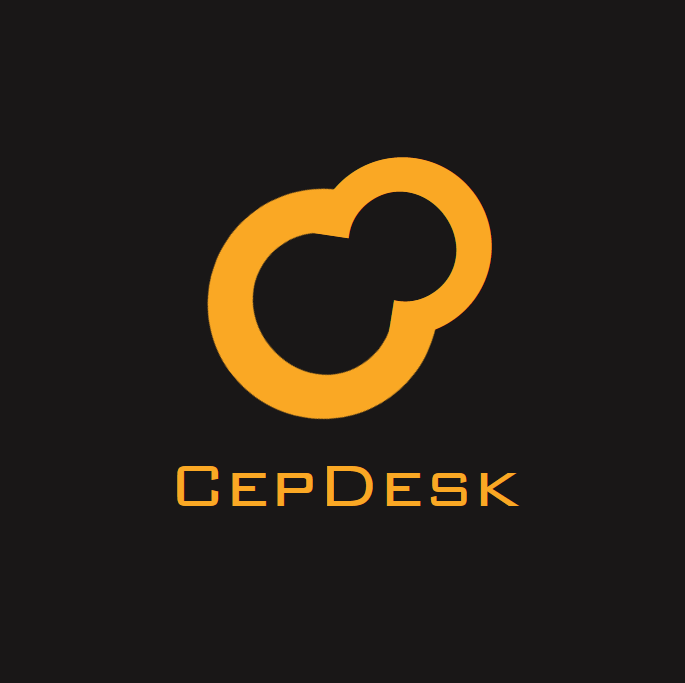

# CepDesk: Türkçe Otomatik Kurulum
<p align="center">
  
</p>

<h1 align="center">CepDesk</h1>


## Özellikler
- PRoot-Distro ile Debian kurulumu
- Native Desktop kurulumu
- XFCE kurulumu
- Termux:X11 desteği
- PulseAudio kurulumu
- Chromium kurulumu
- Otomatik masaüstü başlatma

## Gereksinimler
- Android
- Termux
- Termux:X11

## 📥 Gerekli Uygulamalar (Downloads)

CepDesk'i kullanmadan önce aşağıdaki uygulamaları yükleyin.

### 1. Termux
- [Termux GitHub Releases](https://github.com/termux/termux-app/releases)

### 2. Termux:X11
- [Termux:X11 GitHub Releases](https://github.com/termux/termux-x11/releases/tag/nightly)

**Önemli:** Termux ve eklentilerini aynı dağıtım kaynağından indirin. Farklı kaynakların APK imzaları uyuşmayabilir ve kurulum hatası oluşabilir.

Gerekli uygulamaları yükledikten sonra Termux'u açın ve aşağıdaki kurulum adımlarını takip edin.

## Kurulum

## KURMA KOMUTU:
```
wget -O install.sh https://raw.githubusercontent.com/Celestialus/CepDesk/refs/heads/main/install.sh
bash install.sh
```
## BAŞLATMA KOMUTU:
```
wget -O start.sh https://raw.githubusercontent.com/Celestialus/CepDesk/refs/heads/main/start.sh
bash start.sh
```
## Not:
Kurulduktan Sonra Bunu Yapıştırın otomatik açılacaktır 2. Açılışta |bash start.sh| yazmanız gerekmektedir! 
## 🇹🇷 Projenin Amacı

CepDesk, İngilizce bilmeyen veya Termux komutlarına aşina olmayan Android kullanıcılarının Linux masaüstü ortamlarını kolayca kurabilmesi için geliştirilmektedir.

Amacımız, karmaşık kurulum komutlarını basitleştirerek herkesin Android cihazında Linux masaüstü deneyimi yaşayabilmesini sağlamaktır.

Proje geliştirme aşamasındadır.

## 🇬🇧 Project Purpose

CepDesk is being developed to help Android users who do not speak English or are unfamiliar with Termux commands easily install Linux desktop environments.

Our goal is to simplify complex installation commands and make the Linux desktop experience more accessible to everyone.

This project is currently under development.

## İlham ve Teşekkür

Bu proje, LinuxDroidMaster'ın
Termux-Desktops projesinden esinlenmiştir.

Github:

https://github.com/LinuxDroidMaster/Termux-Desktops

Youtube:

https://www.youtube.com/@LinuxDroidMaster

Orijinal projenin sahibine ve katkıda
bulunan herkese teşekkürler.
